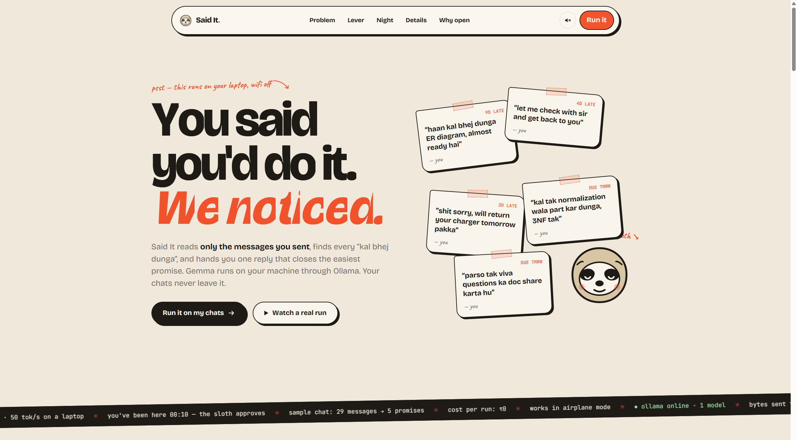
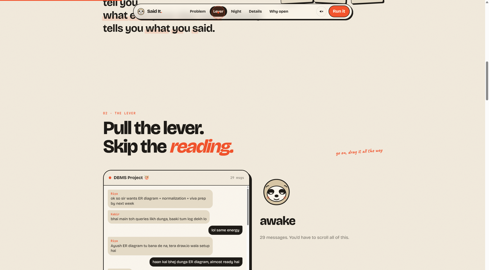
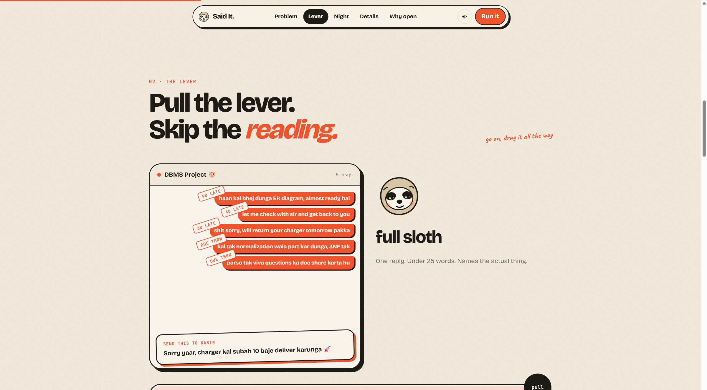
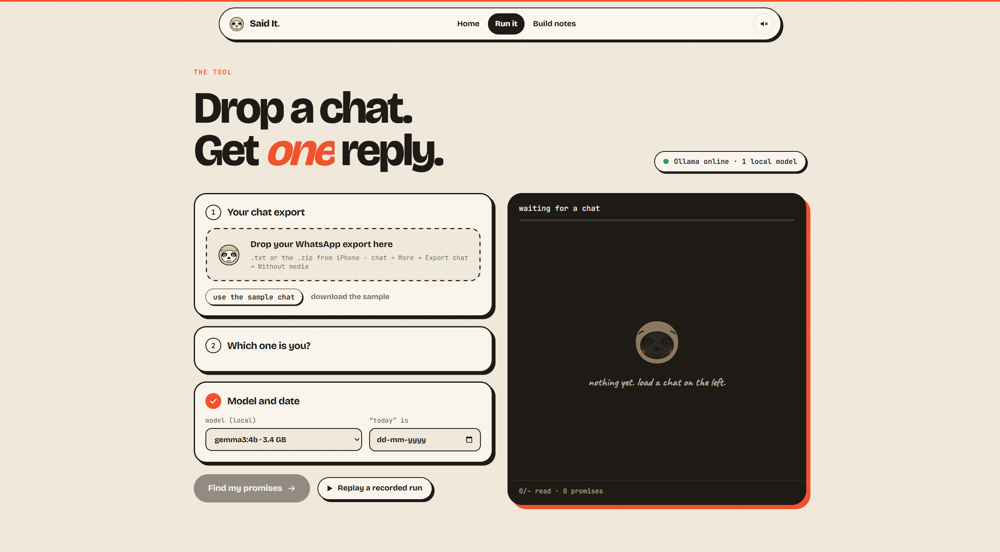
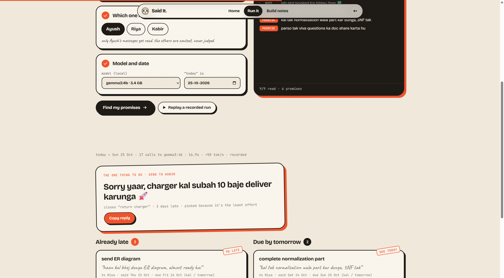

# Said It

Finds the promises **you** made in a WhatsApp export, on your laptop, with [Gemma](https://ai.google.dev/gemma) through [Ollama](https://ollama.com/). Chat text is never sent to a remote API.

**[Live demo](https://ayushkr23.github.io/said-it/)** · MIT · Vite 8 · React 19 · TypeScript


The 1:23 demo: the chat, Gemma finding the promises, and the one reply. Sound on.

---

## What it does

Export a WhatsApp chat (`.txt`, or the `.zip` WhatsApp writes). Drop it in. Said It:

1. Parses the export in the browser
2. Reads only **your** messages
3. Asks `gemma3:4b` to **quote** the commitment words
4. Turns `kal` / `parso` / weekday names into dates **in code**
5. Asks a yes/no “already kept?” question per candidate
6. Drafts **one** reply, under 25 words

On the bundled sample chat (`src/data/sample-chat.txt` + `src/data/recorded.json`):

| | Before | With Said It |
|---|---|---|
| Messages you read | 29 | 6 cards (3 late, 2 due soon, 1 kept) |
| Time | reread the thread | **16.9 s**, 17 local Gemma calls |
| Chat bytes uploaded | whatever you paste into a closed API | **0** (only `localhost:11434`) |
| Cost | per-token billing | **₹0** |

That sample is a smoke test I wrote, not a benchmark. All 6 planted promises were found; the 3 decoys (`lol same energy`, `sent the SQL dump`, `yesss someday`) were not flagged.

---

## Try it

The [hosted site](https://ayushkr23.github.io/said-it/) works **without** Ollama. Open **Run it** and press **Replay a recorded run**.

### Local (3 commands)

You need [Node](https://nodejs.org/) 20+ and [Ollama](https://ollama.com/).

```bash
ollama pull gemma3:4b
git clone https://github.com/ayushkr23/said-it.git
cd said-it && npm i
npm run dev
```

Open [http://localhost:5173](http://localhost:5173). If Ollama isn't running, the recorded run still works.

If you host the site somewhere else and want it to talk to Ollama on your machine, set `OLLAMA_ORIGINS` to that site's address. Until then, replay still works.

```bash
npm run test:parse          # parse the sample chat (no model)
npm run test:parse -- --run # live Gemma run (needs Ollama)
```

---

## How the site works

### Home

The landing page is a walkthrough, not a form. The sloth eats the promises you forgot.



### Pull the lever

Drag the lever (or click **full sloth**). Everyone else's messages drop away, your promises get stamped late / due, and one reply pops out.





### Drop a chat

**Run it** accepts a `.txt` or `.zip` export. Parsing happens in the browser (`fflate` for zip). Nothing is uploaded.



### The verdict

A recorded `gemma3:4b` run on the sample: **17 calls, 16.9 s, ~50 tok/s**. Three late cards, two due soon, one reply you can copy.



---

## Pipeline

```
 WhatsApp export (.txt / .zip, unzipped in the browser)
            │
            ▼
   parse → keep only MY messages (≥3 words, recent)
            │
            ▼
 ┌──────── Gemma 3 4B via Ollama (localhost:11434) ────────┐
 │ 1. classify each message → must QUOTE the promise words │
 │ 2. “already kept?” yes/no per candidate                 │
 │ 3. draft one reply ≤ 25 words                           │
 └─────────────────────────────────────────────────────────┘
            │            ▲
            ▼            │ code checks: quote exists? done-marker?
   due dates in code → late / soon / kept → UI
```

A 4B model is eager to say “yes, promise.” The schema forces `commitment_words` before `is_promise`, and code rejects the result if that quote isn't actually in the message. Past-tense completions (`sent`, `booked`, `done`, plus Hindi equivalents) are filtered before Gemma sees them. Dates are not the model's job.

Hardware this was timed on: RTX 4050 Laptop GPU, Ryzen 7 7840HS, 15.3 GB RAM, Windows. `gemma3:4b` is **3.4 GB** on disk.

---

## Layout

```
said-it/
├── src/lib/whatsapp.ts     # Android-style WhatsApp export parser
├── src/lib/promises.ts     # filter → classify → dates → kept? → reply
├── src/lib/ollama.ts       # one fetch to localhost:11434, JSON-schema output
├── src/pages/Run.tsx       # drop an export, run live or replay
├── src/sections/           # lever, night timeline, details, open switch
├── src/data/sample-chat.txt
├── src/data/recorded.json  # the 17-call run used for Replay
└── scripts/check-parse.ts  # npm run test:parse
```

---

## Limits

- Accuracy is measured on **one** sample chat I wrote.
- The parser targets the Android export format. The UI accepts a `.zip` (iPhone exports often arrive that way); treat iOS as unverified.
- Fonts load from Google Fonts. Chat data does not go with that request. “Works with wifi off” is not verified.
- There is no unit-test suite. `npm run test:parse` is an end-to-end check script.

---

## License

[MIT](LICENSE)
